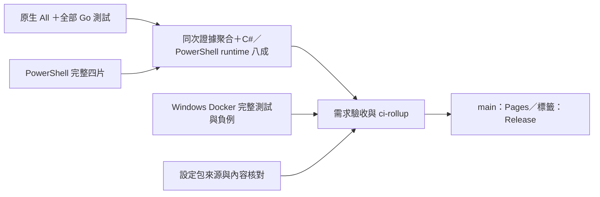

# CI 與本機測試

## Windows CI
設定資產依平台分層驗證：Server runner 對真實三檔執行來源／雜湊／XML 正負測試，另以原生 WIM 唯讀抽取核對已審查基線。Windows 11 client 的 `Get-ProvisioningPackage` 不在 Server runner 提供；runtime 仍強制呼叫它，沒有略過或降級。要在 Windows 11 本機重做原生 metadata 六項唯讀檢查，可從儲存庫根目錄執行：

```powershell
powershell.exe -NoProfile -ExecutionPolicy Bypass -File script/test/verify_client_provisioning.ps1
```

此指令只讀取設定包，不建立帳號、不套用設定；平台支援範圍見 [Microsoft 原生 cmdlet 文件](https://learn.microsoft.com/en-us/powershell/module/provisioning/get-provisioningpackage)。

工作流程位於 .github/workflows/windows_tests.yml：使用 windows-2022、Windows PowerShell 5.1、唯讀 contents 權限，設定執行時間上限與併發控制。Action 固定到已核對的 commit。main 推送、版本標籤、Pull Request 與 workflow_dispatch 都可觸發；ci-rollup 統一呈現測試門檻。

### PR、main 與 tag 的三個階段

Windows 測試依事件分成三個階段，必要檢查名稱 `ci-rollup` 不變：

| 階段 | 事件 | 內容 |
| --- | --- | --- |
| push-to-branch（PR） | `pull_request` | `classify` 比對 PR 與 base 的 diff 輸出 `select_*`；只改文件時僅跑 `doc-checks`；程式碼 PR 只跑受影響的 suite、合併標題核對與設定包唯讀驗證；共用路徑或無法判斷時跑完整套件 |
| push-to-main | `push`（main）、`merge_group` | 一律完整套件，包含 isolated-tests、全源量測、docker-tests、覆蓋率聚合、requirements-gate 與部署 |
| release | `push` tag | 完整套件加既有發布流程 |

純文件 PR 指所有變更路徑都是根目錄 `*.md`、`license`、`doc/**/*.md` 或 `.github/pull_request_template.md`。第三方內容中的 `LICENSE`、含上層路徑或反斜線的路徑、非 Markdown 檔一律不算文件。文件檢查清單由 `script/test/ci_classify.ps1` 讀取現有 PowerShell 測試推導：列入引用被改文件路徑的測試，以及名稱屬於全域契約（architecture、layout、Markdown 換行）的測試，不在 workflow 內手寫路徑表，並以 `run_ci.ps1 -Suite` 在完整清單檢查之後只執行這些 suite。

分類以 `git diff --no-renames` 取得變更，改名會同時列出舊路徑與新路徑，因此把程式碼改名成 Markdown 不會被當成文件。分類失敗、取不到 diff 或路徑無法判斷時，一律選完整套件（fail open）。

程式碼 PR 的受影響 suite 由 `Get-CIScopedTests` 推導，不手寫路徑表：從每個變更路徑出發，找出文字內容引用它的檔案（完整相對路徑或獨立的檔名），再沿引用鏈往上追，直到碰到 `test/powershell/unit` 或 `integration` 的 suite；被改的測試檔自己一定執行，文件與 `architecture`、`layout`、`markdown_line_ending` 這類全域契約測試一併列入。刪除的檔案以測試中仍存在的引用判斷，改名視為舊路徑刪除加新路徑新增。下列情況一律完整套件：路徑含上層、反斜線或空段；`.github/`、`go.mod`、`go.sum`、`vendor/`、`.version`、容器與 `script/docker/`、`script/test/` 的 CI 與覆蓋率工具、`test/powershell/` 的 helpers／support／coverage 與 fixtures 根目錄的腳本（`fixtures/<目錄>/` 的重放資料與根目錄的資料檔改走引用鏈：suite 以 `fixtures/<目錄>` 或檔名引用時只選這些 suite，被測試輔助程式引用、無人引用或與共用輔助程式同時變更則維持完整套件）、`core/paths.*`；任何 Go 變更（Go 整合測試依賴完整 PowerShell 報告）；任一路徑沒有測試引用；引用鏈超過 300 個檔案，或受影響 suite 超過全部 suite 的一半（縮小收益有限）。登錄表或總入口（對外引用超過 30 個檔案，例如 `core/paths.json`）不當作引用鏈的中繼點，因為它只是列出檔案，不代表依賴。以最近 60 筆合併回放，約七分之一只改文件、近三成可縮小，其餘因 workflow、`core/paths.*`、Go 或共用輔助變動而維持完整套件。縮小範圍時 `isolated-tests` 只執行 `-Suite` 清單與 mergecheck，略過 Go 測試、報表排版、原生證據封裝與合成樣本；`powershell-coverage`、`coverage-aggregation`、`requirements-gate`、`docker-tests` 計為依分類略過。`ci-rollup` 帶入事件名稱，只在 `pull_request` 接受分類略過；`push`、`merge_group`、tag 與手動執行的任何略過都使整體失敗。
分類工作在 Linux 執行，分類腳本與其載入的檔案不得呼叫 `.exe`（變更路徑以 `git` 取得）；工作內的 `Invoke-CIClassifierSmoke` 以暫時 git 倉庫真實執行 PR 自己的分類器，只改文件的變更必須得到輕量文件檢查，退回完整套件即失敗。分類失敗退回完整套件時，classify 與 ci-rollup 的 step summary 會明確標示「改跑完整套件」並附原因，`classify_fallback` 輸出為 `true`。

無法縮小的程式碼 PR（共用路徑、沒有測試引用、受影響 suite 超過一半）在 PR 階段不再跑完整套件：分類結果改為 `pr_full=true`，`test_scope=scoped` 並以全部 suite 當作 `affected_tests`，`isolated-tests` 依 `shard_count`（受影響 suite 的實測權重總和除以 250 秒，限制在 1 到 4 片）以 `shard_matrix` 展開成矩陣，每片 `-Parallelism 2`；Go 維護工具單元測試（不含需要完整 PowerShell 報告的 `test/go/integration`）由獨立的 `go-tests` 工作以 `Invoke-CIGoUnitTests` 執行（`select_go_tests`）。`powershell-coverage`、`coverage-aggregation`、`requirements-gate`、`docker-tests` 在 PR 階段略過，留給 `merge_group`、main 與 tag；`ci-rollup` 只在 `pull_request` 接受這些分類略過，被選取卻 skipped 的 `go-tests` 仍使整體失敗。取不到 diff、沒有可讀取的根目錄、範圍判斷本身丟出例外或分類失敗仍是完整套件。代價：歷史上 116 次 PR 與合併佇列執行中，isolated-tests 通過但 docker-tests 失敗共 2 次（約 1.7%），這類問題改在合併佇列才被攔下並踢出佇列。

共用規則在 `script/test/ci_classify.ps1` 的 `CISharedPathRules` 逐條命名（workflow、go_module、version、container、ci_tools、test_support、path_registry、go_source），每條各有只靠該規則才走完整的測試，單獨移除任一條就會讓對應路徑被判為可縮小。

分類腳本取自 PR 的基底版本（獨立 checkout 到 `base-source`），PR 不能用自己修改過的規則判斷自己；基底還沒有該腳本、腳本失敗或事件不是 PR 時，由 workflow 內嵌的固定輸出改跑完整套件，不依賴任何 PR 可改的檔案。改到分類規則或 workflow 的 PR 因此一律完整。`ci-rollup` 帶入事件名稱且不設預設值，缺少時直接拒絕，只在 `pull_request` 接受分類略過；`push`、`merge_group`、tag 與手動執行的任何略過都使整體失敗。

登錄表或總入口（對外引用超過 30 個檔案，例如 `core/paths.json`）不當作引用鏈的中繼點，因為它只是列出檔案，不代表依賴。已知限制：以字串拼接或動態組路徑載入的依賴看不到引用；只經由樞紐才與變更檔相連的 suite 會被漏掉。這兩類由 merge_group 完整套件補上；沒有任何測試引用的變更路徑則直接選完整套件，不會因此變成零測試。

已知取捨：縮小範圍的 PR 不執行 Go 測試與全源覆蓋率，可能被引用鏈漏掉的跨檔影響由合併佇列的 merge_group 完整套件在進入 main 之前擋下（必要檢查 `ci-rollup`，無繞過），main 與 tag 再完整執行一次。文件檢查清單只由 PowerShell 測試內容推導，讀取 Markdown 的 Go 測試與 requirements-gate 在純文件 PR 不執行，改由 main、merge_group 與 tag 的完整套件補上，此為已知取捨。`ci-rollup` 只有在分類工作成功、對應 `select_*` 明確為 `false` 且該工作確實 skipped 時，才把略過視為通過；被選中的工作失敗、取消或略過都使整體失敗。這是政策語意變更：純文件 PR 不再於 PR 階段執行全來源量測與容器測試，完整驗證改由 main、merge_group 與 tag 強制。

### 平行測試與完整證據聚合

原生完整測試、Go 維護工具測試與四片 PowerShell 量測平行執行。聚合核對本次提交、執行 ID、attempt 與來源雜湊後，結合 C# 量測，產生 runtime 覆蓋率及正式報告。



`native-stage-執行ID-attempt` 是不可發布的中介附件，只含明確白名單的原生報告並標示覆蓋率尚未完成；沒有 managed 編譯檔、私有路徑或原始日誌。聚合重新驗證完整 native 測試清單及原始位元組；錯誤來源、不同 attempt、少片或變造都會失敗。只有完整八成門檻通過後，聚合才上傳 `windows-test-reports`，Release 與 Pages 不讀取中介附件。

版本標籤通過門檻後，CD 以 `report_bundle_tool` 封裝並驗證同次 Windows 原生及容器公開報表，作為該版 Release 的單一報表 ZIP。`verify --output-dir` 可在完整驗證成功後輸出原始檔案及 `verified.json` 摘要；呼叫端須先建立專用、空白且無其他寫入者的私有父目錄，工具不驗證 ACL。消費者仍須對照不可變 Release 的 ZIP 大小與摘要。歷史不可變版本可用 `verify --historical --archive-sha256 <SHA256> --archive-size <位元組數>` 核對外部 Release 附件後驗證；此模式從封裝讀取 run 與 attempt，只代表不可變報表自述，並非獨立來源認證。版本、提交與乾淨精確來源仍為必要輸入。輸入工件的 run 與 attempt 由 CI 精確選取並提供，manifest 記錄此脈絡，不將封裝本身視為獨立來源認證。原生報告保留實際覆蓋率證據，容器報告維持原本的未量測狀態。

main 部署後核對公開首頁及同次完整來源；Tag 部署後核對公開版本索引、版本頁、同次報告，以及摘要與不可變 Release 封裝的位元組和雜湊。歷史版本保留當時的 Go profile 與原量測口徑。

此分工參考 [PowerShell 的平行測試與最終門檻](https://github.com/PowerShell/PowerShell/blob/638faa6d1d2e0f859a31587c471d85284c26f36f/.github/workflows/windows-ci.yml)及 [Moby 的 Windows producer／artifact consumer](https://github.com/moby/moby/blob/23ea0fa6461ec7455486441ae3a52b1235cdbec0/.github/workflows/.windows.yml)。現有 suite 與 Docker 完整測試均保留；runtime 覆蓋率門檻為八成。

CI 工具下載參考 [PowerShell 官方安裝器](https://github.com/PowerShell/PowerShell/blob/638faa6d1d2e0f859a31587c471d85284c26f36f/tools/install-powershell.ps1)，在當次下載內停用 Windows PowerShell 原生進度並恢復偏好；工具解壓使用不輸出進度的 .NET ZIP API，仍先核對官方雜湊並保留開始、完成與耗時訊息。這不影響 `windows.cmd`、Windows Update 或其他產品模組的使用者進度。

[工具冷建置量測](https://github.com/ycpss91255-lab/windows_setup/actions/runs/42998017653)約 4.0 分鐘，對照 [原始執行](https://github.com/ycpss91255-lab/windows_setup/actions/runs/42985099571)約 29.6 分鐘。這是相同 runner 映像與工具版本的兩次冷建置，分別使用不同的 fresh job，不是同一實體 VM，也不是統計上的效能保證。比較只涵蓋工具建置階段；完整測試與量測仍執行，整輪耗時依正式 Actions 當次結果核對。

Windows 測試映像的健康檢查每 30 秒檢查一次工具是否可回應，單次逾時 10 秒，連續失敗三次才標記 unhealthy。這只反映探針當下的工具狀態，並不代表測試通過；一次性測試容器可能在首次檢查前結束，仍以測試程序退出碼與報告為準。

### 自動報表與徽章

若公開 Pages 版本頁缺失，可在 GitHub **Actions → Windows 測試 → Run workflow** 選擇 **main** 並執行；工作流程會重新完成全部必要測試與覆蓋率門檻，然後重建、部署並驗證入口及已發布的不可變最新版。請等該次工作全數完成並查看結果；非 main 的手動執行不會部署，恢復不會重發或更動既有 Release 與標籤。恢復成功不會改寫先前失敗紀錄，也不代表已查明公開可見性異常的根因。

CI 使用與 base 相同的 GitHub Actions 原生徽章；runtime 覆蓋率使用儲存庫自行產生的 flat SVG。Pages 作為自行產生的靜態後端，提供 main 徽章與連結的詳細報表；完整版本報表的下載方式見上方說明。不依賴 Codecov、Coveralls 或外部報表平台。

在 GitHub Actions 的 Summary 可查看測試與聚合後的 PowerShell/C# runtime 覆蓋率；各 PowerShell 分片另列量測階段耗時。範圍為 `core/`、`modules/` 中的 PowerShell，以及 `modules/*/native/*.cs` 的 C#；以可執行行加總，不取語言百分比平均。CMD 啟動器的功能與契約測試、Go 維護工具測試仍須通過，但兩者不計入覆蓋率，Go 不設覆蓋率門檻。新增範圍外 runtime 可執行種類時必須明確更新範圍，缺來源或量測時拒絕發布。歷史報告保留當時口徑，不轉標為新指標。

此計時的 instrumentation 來源為同次 runtime PowerShell（`core/` 與 `modules/`，排除第三方）；suite 清單仍涵蓋全部安全 unit 與 integration 測試。維護者可在該次 Actions 附件下載 `powershell-timing-complete-<run_id>-<attempt>`，查閱已與全部分片實際 worker 身分及完整 suite 清單核對的階段毫秒數。`worker_setup` 從 worker 腳本開始計時，不包含程序建立前等待；`pester_instrumentation_and_test` 包含 Pester instrumentation 與測試，兩者未分開量測；`serialization` 包含測試後驗證與 worker 證據序列化。計時不是覆蓋率或測試通過證據，不應用於替代同次測試；排隊時間與分片、聚合 job 的執行時間仍須以 Actions 時間資料另行區分。單次數值與模擬均不保證效能改善。

每次測試從實際斷言事件及程序退出碼產生 JSON、Markdown、自含 HTML、JUnit XML 與徽章。程序崩潰、缺少斷言事件或任何失敗均不能標成通過。新增 `test/powershell/unit` 或 `integration` 測試會自動列入執行清單。公開報表只包含靜態檢查、單元與隔離整合結果。

PR 的去識別測試附件保留七天；main 通過全部必要門檻後更新 Pages，失敗時公開徽章仍保留上次成功部署的證據。連續合併時，head 提交已是目前 main 祖先的舊 main run 會在建立索引時明確標示「main 已前進」並略過索引與發布（由不綁 `github-pages` 環境的 `pages-freshness` 工作在發布前確認，main 已前進時整個發布工作被略過，不留下部署紀錄；發布工作內於部署前再確認一次），由最新的 main run 建立；run 的 branch、event、attempt、id 不符或提交不是 main 祖先仍會失敗並列出差異。新版 Release 的報表 ZIP 長期保存 `repo_coverage.json`、`coverage_inventory.json`、`coverage.xml` 與兩種環境的測試摘要，核對來源、計量、雜湊及計數。歷史版本依原始證據整理頁面並連回不可變原始附件；缺紀錄就如實說明，不以目前測試回填。

維護者接線依序為：產生三份 runtime 證據 → `script/test/attach_repo_coverage.ps1` 附加到測試報表 → `script/report/build_portal.ps1` 或 `publish_quality_release.ps1`。三個入口都使用已建置的 `repo_coverage_tool`，由 `-CoverageToolPath` 或 `WINDOWS_SETUP_COVERAGE_TOOL` 指定；缺工具、缺來源、未完整量測或未達精確 80% 都會停止。附加時以 `-SourceRoot` 核對真實 checkout。`build_portal.ps1 -Preview` 僅供本機合成樣本，不得用於正式 Pages 或 Release；本輪 publisher 不接受舊覆蓋率口徑。

正式 Pages 必須提供同一 main run 與 attempt 的原生和容器報告；`build_portal.ps1` 以 `-MainSnapshotPath`、`-ContainerSnapshotPath` 指定兩份摘要，並由 `-BundleToolPath` 或 `WINDOWS_SETUP_REPORT_BUNDLE_TOOL` 指定已建置的報表驗證工具。兩份報告各自保留測試分母；容器覆蓋率未量測，不與原生合併。新版 ZIP 以 `presentation` 標記單頁版面，現行工具也能驗證缺少該欄位的歷史封裝；舊版嚴格驗證工具可能拒絕新版 ZIP，驗證時請使用與 ZIP 同版的工具。

各機續跑及排錯的 `reports` 保留於該機，不納入 Git 或 Pages。`windows.cmd -AfterRestart` 與 `windows.cmd -VerifyOnly` 是產品功能，繼續供設定後續跑及檢查。

### 測試分層與本機入口

測試依 base 的 tool-first 方式放在 `test/powershell/<層級>`；純函式／模擬 Windows API 的單元測試與實際跨元件的隔離整合測試分開執行，不把同一套測試重複掛名兩層。

| 層級 | 範圍 | 執行環境與限制 |
| --- | --- | --- |
| `unit` | Init 路由、帳號／密碼與 XML；硬體適用性、略過與結果彙總；輸入法模組 | Windows API 以 mock 取代，不建立真實帳號或修改使用者語言 |
| `integration` | 清理器與暫存 Windows 目錄；硬體入口、包身分／雜湊、獨立驅動包導出；hosts 規劃；真實 Git 發布；來源結構與入口路由 | 使用暫存檔案及隔離 Git，實際組件協作，不安裝驅動或套用系統偏好 |

```powershell
# 維護者先準備固定 workflow 語義檢查器（只放 TEMP，不做全域安裝）
. .\script\docker\install_managed_tools.ps1
$lintDirectory = Join-Path $env:TEMP ('windows_setup_actionlint_' + [guid]::NewGuid().ToString('N'))
Install-ContainerToolArtifact -Artifact (Get-ContainerWorkflowLintArtifact) -Destination $lintDirectory -ArchiveDirectory (Join-Path $lintDirectory 'download')
$env:WINDOWS_SETUP_ACTIONLINT = Join-Path $lintDirectory 'actionlint.exe'
# 既有已備妥的 actionlint 1.7.12 亦可直接用此環境變數指定絕對路徑。
# 全部單元與隔離整合測試（預設）
powershell.exe -NoProfile -ExecutionPolicy Bypass -File .\script\test\run_ci.ps1
# 只跑指定層；仍會進行語法檢查
powershell.exe -NoProfile -ExecutionPolicy Bypass -File .\script\test\run_ci.ps1 -Layer Unit
powershell.exe -NoProfile -ExecutionPolicy Bypass -File .\script\test\run_ci.ps1 -Layer Integration
```

Workflow 隔離整合測試使用固定的 [actionlint 1.7.12](https://github.com/rhysd/actionlint/releases/tag/v1.7.12)，真實檢查 YAML 的 GitHub context 可用範圍、運算式及工作相依；同時以正負控制樣本防止只做 YAML 語法檢查。下載前述 ZIP 會核對官方 SHA256，CI 主機及 Docker 建置會自動準備；容器執行保持離線。這是儲存庫維護工具，一般使用者執行 `init.cmd`／`windows.cmd` 不需要它。

報告每項包含 `Layer`、`Status`、`Executed`。未選擇的隔離層不宣稱已執行。`SourceOnly` 只略過 Git 不含的安裝二進位，仍檢查程式、資產、驅動中繼資料及入口。

### 開發用 Windows Docker 環境

這是維護者的程式與隔離測試環境。控制入口沿用 base 將維護操作集中於工具腳本的方向，採 Windows 原生 PowerShell；不宣稱與 base 的 Linux／just 指令完全相同。一般使用者從 USB 執行 `init.cmd`／`windows.cmd` 不需要 Docker。

先準備可使用 **Windows containers** 的 Docker engine 與 Compose v2，建議使用乾淨、未放入個人資料的完整 Git checkout（必須包含 `.git` 目錄）。Linux containers 模式不能執行這份 Windows PowerShell 5.1 環境。Windows Server 與 Windows 用戶端的隔離模式相容條件不同，依 [Microsoft 容器需求](https://learn.microsoft.com/en-us/virtualization/windowscontainers/deploy-containers/system-requirements)與[版本相容說明](https://learn.microsoft.com/en-us/virtualization/windowscontainers/deploy-containers/version-compatibility)設定；使用 Docker Desktop 時另依 [Docker 官方 Windows 安裝條件](https://docs.docker.com/desktop/setup/install/windows-install/)。本工具只檢查，不會自動安裝 Docker、切換引擎或啟用主機功能。

在儲存庫根目錄開啟 PowerShell：

```powershell
# 只檢查目前 Docker／Windows container 能力
powershell.exe -NoProfile -ExecutionPolicy Bypass -File .\script\docker\docker.ps1 -Action doctor
# 建立開發映像
powershell.exe -NoProfile -ExecutionPolicy Bypass -File .\script\docker\docker.ps1 -Action build
# 建置最新映像並執行全部單元／隔離整合測試
powershell.exe -NoProfile -ExecutionPolicy Bypass -File .\script\docker\docker.ps1 -Action test
# 開啟容器內的 PowerShell 開發終端
powershell.exe -NoProfile -ExecutionPolicy Bypass -File .\script\docker\docker.ps1 -Action shell
```

預設使用 `process` 隔離；有相容 Hyper-V 環境時可明確加 `-Isolation hyperv`。`test` 自動建置，不會沿用不明版本映像。完整來源 checkout 以唯讀方式掛載，包含 `.git` 與被 Git 忽略的本機檔案，容器能讀取它們；這不是去識別的來源副本。建置 context 另由 `.dockerignore` 白名單限制。容器 shell 用於檢查與執行程式，不能直接編輯唯讀來源；請在主機編輯後重跑測試。報告寫入儲存庫以外的新目錄；預設位置會顯示在輸出，也可用 `-ReportDirectory` 指定一個尚不存在的絕對路徑。容器失敗會回傳非零退出碼，不會以空報告或略過當作通過。

CI 的 Docker 工作總預算為 125 分鐘：就緒檢查 3 分鐘、映像建置 60 分鐘、健康與逾時驗證 4 分鐘、完整容器測試 35 分鐘、失敗負例與報告驗收各 5 分鐘，另留 13 分鐘供準備、程序清理及上傳。建置收據綁定來源提交、完整工具輸入、隔離模式與實際映像 ID；後續 `test-built` 將已驗證設定複製至來源外的私有暫存設定，只移除建置指令並鎖定映像 ID，重新使用真 Compose 解析及核對原有唯讀掛載、命令、隔離與其他設定，再以 `--pull never` 執行；缺少或不符即失敗，暫存設定於結束後清除。這是 CI 的分段入口；一般維護者仍可使用自動建置的 `-Action test`。容器內完整測試以 `run_ci.ps1 -Parallelism 2` 同時執行兩個 suite 子程序，清單中的每個 suite 仍恰好執行一次，報告順序與序列相同，單一 suite 失敗仍使整體失敗；其他入口與 `isolated-tests` 預設仍為序列。這項調整只縮短牆鐘時間，不改變 suite 清單、報告格式或任何門檻。官方下載與通過雜湊驗證後的解壓會分別輸出耗時，便於診斷，不把未完成的測試算作通過。

維護工具以 Go 為主要實作語言；Windows 原生設定與 PowerShell 5.1 測試保留 PowerShell，一般使用者執行設定不需要 Go。根目錄 `go.mod` 僅管理 `script/test` 工具與 `test/go` 案例，沒有改變交付程式的依賴方向。HTML5 解析使用固定版本的官方 `golang.org/x/net/html`，其餘驗收使用標準庫；必要上游原碼及授權保存在 `vendor`，離線容器不下載模組。

直接執行 Go 測試時，在完整 checkout 根目錄使用 `go test -mod=vendor -count=1 ./...`，並將 `WINDOWS_SETUP_ARTIFACT_DIR` 指向 PS5.1 產生的 public 報告、`WINDOWS_SETUP_PORTAL_FIXTURE_DIR` 指向 `script/test/create_portal_fixture.ps1` 產生的 portal 目錄。兩者缺少即失敗，不以跳過掩蓋缺證據；上述 Docker `test` 入口會自動準備這些輸入。Go 單元及整合測試包含原有 21 項驗收契約與新增解析／命令列邊界案例，結果獨立於 PS5.1 報表數量。

容器映像提供 Windows PowerShell 5.1、固定版本且核對雜湊的 MinGit 與 Go 1.27.3。一般本機未設定 GitHub 執行來源時，PS5.1 仍測試目前真實 checkout，保留其 Clean／Dirty 狀態；Go 需求合約使用另外明確標示 Synthetic 的暫存樣本，不改寫或冒充本機正式報告。本機模式不產生已通過 80% 的 CI 覆蓋率證據。CI 必須以本次真實報告驗收，正式發布要求 PowerShell/C# runtime 量測完整並以原始覆蓋行數通過精確 80% 門檻；GitHub 提交、儲存庫、執行 ID、ref 類型與 ref 名稱這五項只要部分存在或格式錯誤就停止，不會降級成合成證據通過。

GitHub hosted Windows 的 Docker 預檢在兩分鐘內確認真實 Windows daemon；未就緒時最多啟動或重啟 Docker 服務一次。所有探測、服務操作與輸出等待共用期限，失敗仍阻擋發布。這項恢復不會套用於本機或 self-hosted runner，也不會切換引擎、修改網路或安裝 daemon。

CI 的容器測試使用真正的 `windows-2022` runner 執行 Docker build/run，並由 `docker-test-shards` 平行拆成數份：份數由 repo 變數 `DOCKER_SHARDS` 決定（未設為 3，只接受 1–6 的整數，其他值使 classify 失敗），各份在自己的 runner 建置同來源映像，以 `run_ci` 相同的實測權重分派規則只執行分配到的 PS5.1 單元／隔離整合 suite，各份互不重疊、聯集等於完整清單。第 0 份另含語法檢查，並在容器內產生明確的合成首頁樣本、執行全部 Go 測試及需求正負例。必要檢查 `docker-tests` 是合併閘門：任一份失敗、取消或被略過即失敗；它以同一份 suite 名冊核對各份報告沒有重複、缺漏或名冊外的 suite、提交與執行來源一致、第 0 份已完成容器內 Go 驗收，才重寫成一份完整容器報告。重跑時請選「重新執行所有工作」，只重跑失敗分片會因附件屬於舊 attempt 而合併失敗。合併工作另核對容器報告中的提交、執行來源、測試狀態與環境，不以主機驗收代替容器內 Go 執行。PS5.1 報表的套件／斷言統計不把 Go 驗收數量混入；Go 結果與實際退出碼另列於 Docker 工作日誌。`ci-rollup` 同時要求主機測試、需求驗收及 Docker 測試成功。在 [Actions](https://github.com/ycpss91255-lab/windows_setup/actions/workflows/windows_tests.yml) 開啟該次執行，於 Artifacts 下載 `docker-test-reports-執行ID-重試次數`，解壓後開 `index.html`；這是容器的獨立 public 報告，只保留七天。原始 logs 不上傳。Pages 的 main 單頁呈現同一 run 與 attempt 的 Windows runner 和 Windows container 兩種環境，測試分母分別列出；容器覆蓋率標示為未量測（NotMeasured），不與原生量測合併。Docker 門檻未通過時不發布新的 Pages 報表。

每次 CI 將去識別的 HTML／JSON／Markdown／JUnit 與徽章上傳為 windows-test-reports artifact，保留 7 天；原始套件 log 不上傳。 完成的 PowerShell collector 另匯出 powershell-raw-evidence 附件保留 7 天，即使後續 runtime 彙整失敗也可重播原始命令計數；附件只含核對過的相對路徑 JSON／XML，不包含 stdout、Pester 原始 XML 或帶絕對路徑的收集清單。這是分項原始證據，不表示 runtime 覆蓋率門檻通過。另有 requirements-fixture artifact，只含程式明確建立的合成首頁樣本，固定假 SHA、示例執行網址及 Synthetic 環境標記，不含帳密或實機資料，同樣保留 7 天供需求門檻驗證。這份樣本不是正式測試證據，不混入 windows-test-reports、Release 或 Pages。其他測試副本、帳號 answer XML、每機 Reports 與秘密均不上傳。Actions 本身執行 log 的保留天數另由儲存庫設定控制，不是 YAML artifact 保留期。

完整 PowerShell 量測由四個 Windows 工作平行執行，原生完整測試與 Go 測試另行同時執行；managed 原生程式量測也由獨立工作與分片同時執行，只上傳聚合所需的證據檔；聚合僅下載同次、同 attempt 的證據並照常核對來源雜湊，不再於串行尾段安裝 .NET 或重新量測；每片保留 runtime PowerShell 來源分母，聚合重新核對同一提交、執行 ID、attempt、原生測試及 wrapper 雜湊後才完成。重新量測時，在 Actions 選擇「重新執行所有工作」（Re-run all jobs），讓四片、原生 producer 與聚合使用新的同一次 attempt；只重跑失敗工作而混用舊片會被拒絕，不會沿用先前的計數補成通過。

實機 Setup-Result.json、Setup-Progress.json、Acceptance-Result.json 與驗證結果是續跑或排錯資料，原有 Git 忽略規則保留；CI 不清理這些檔案。設定未完成時不要刪除 Setup-Result.json。
